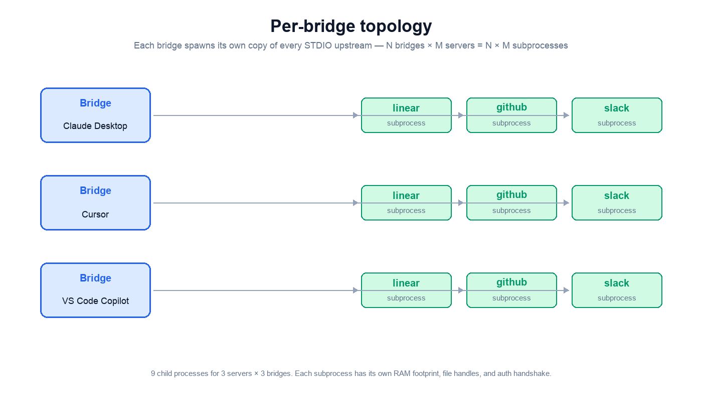
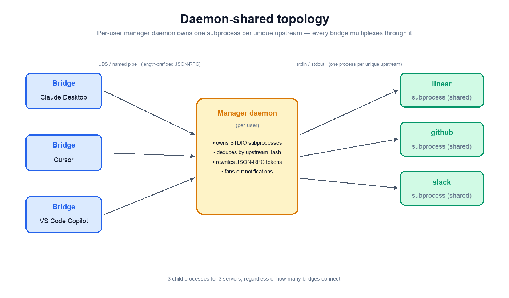

# STDIO manager

The STDIO manager is a per-user background process the bridge spawns automatically. It owns every STDIO upstream MCP server and lets multiple bridges share one subprocess per upstream — so running Claude Desktop, Cursor, and a CLI bridge against the same Linear MCP server doesn't spawn three copies of the Linear MCP server.

The manager is mandatory for STDIO upstreams; there is no inline fallback. HTTP and SSE upstreams are unaffected — each bridge connects to them directly.

## Why it exists

Without the manager, every running bridge spawns its own copy of every configured STDIO upstream MCP server. Run **N bridges** (one per editor / agent) against **M servers** and you get **N × M subprocesses**. Each one consumes its own RAM, file handles, and re-runs the upstream's auth handshake.

The manager collapses this: it owns the STDIO subprocesses and multiplexes sessions from every bridge. Identical upstream specs across bridges share a single child.





## How sharing works

Each upstream is identified by an **`upstreamHash`** — a SHA-256 of the canonical form of `(command, args, resolvedEnv, cwd)`. Every bridge whose upstream has the same hash shares one child; different credentials → different hash → different child. The server's name in your config doesn't count, so two entries with different names but the same command, arguments, environment and working directory share a child.

`_bridge.sharing` and the `_bridge.daemon` auto-fork settings no longer exist; the bridge ignores them and logs a warning when a config still sets them.

A shared child serves all of its bridges at once. A server that keeps state in memory, such as a browser it opened, shares that state with every assistant using it. To keep two copies of a server apart, give them different `env` or `args`.

The bridge dedupes config entries by `upstreamHash` locally — duplicate identical entries collapse to one session before reaching the manager.

## Initialize cache

The first bridge session against a child runs a real `initialize` round-trip. The manager caches the result and replays it on every subsequent session's `initialize` for the same child — the call never reaches the child a second time. The cache covers `protocolVersion`, `serverInfo`, `capabilities`, and (when the upstream advertises one) the `instructions` text used by the bridge's [`_bridge.passthrough`](configuration.md#context-passthrough) feature, so all sessions see the same instructions regardless of attach order.

## CLI

The manager is started automatically on first bridge connect. The `daemon` subcommand exists for manual control:

```bash
crabeye-mcp-bridge daemon start      # spawn the manager (no-op if one it doesn't need to replace is running)
crabeye-mcp-bridge daemon stop       # graceful shutdown; stops an unresponsive manager too
crabeye-mcp-bridge daemon status     # pid, uptime, crabeye version, and requests from upstreams it refused
crabeye-mcp-bridge daemon restart    # stop + start
```

`crabeye-mcp-bridge daemon --internal-launch` is a hidden, internal-only entrypoint used by the bridge to fork the manager process. Don't use it directly.

### Restarting a single upstream

If the upstream binary is updated on disk but its `upstreamHash` is unchanged (e.g. `npm update -g`, `brew upgrade`, dev rebuild), the manager won't notice — its hash hasn't changed. Trigger a forced respawn manually:

```bash
crabeye-mcp-bridge daemon restart-upstream <upstreamHash>
crabeye-mcp-bridge daemon restart-upstream --all
```

Requests still in flight on the killed child fail with an "upstream restarted" error. Each bridge using that child reconnects on its own and gets a fresh child, so the next tool call goes through without restarting the client.

The same happens when a child crashes, stops answering health pings, or floods its output: its bridges reconnect to a fresh child instead of waiting for requests to time out.

## Configuration knobs

All knobs live under `_bridge.daemon.*` in the bridge config:

| Key | Default | Meaning |
|-----|---------|---------|
| `idleMs` | `60000` | The manager self-exits this long after the last bridge disconnects. |
| `graceMs` | `60000` | A child stays alive this long after its last session detaches, in case another bridge reattaches. |
| `rpcTimeoutMs` | `30000` | Per-RPC timeout on outbound bridge→manager calls. Stalled responses past this trigger a force-respawn. |
| `heartbeatMs` | `5000` | Bridge sends a PING this often. Missed heartbeat (`heartbeatMs * 3`) trips force-respawn even with zero in-flight RPCs. |

The child grace timer and the manager's idle timer compose independently — the manager exits roughly `graceMs + idleMs` (≈2 min by default) after the last bridge disconnects.

## What happens when I edit my MCP config and save?

Bridge has hot-reload: it reads the saved config and reconciles upstream sessions. Two cases:

1. **The config change mutates the `upstreamHash`** (e.g. you changed `args`, `command`, `env`, or `cwd`). The bridge OPENs a fresh session against the new spec; the manager spawns a new child for the new hash. The old child grace-kills once its refcount drops to zero. **No manual action needed.**

2. **The config change does NOT mutate the `upstreamHash`** (e.g. you only edited `_bridge.toolPolicy`, or you upgraded the upstream binary on disk in place). The manager still has the old child cached. Bridge picks up the policy change, but the *binary* hot-swap requires:

   ```bash
   crabeye-mcp-bridge daemon restart-upstream <hash>
   ```

   This is the only case where you need to invoke the `daemon` CLI manually.

### Where do paths live?

* **Unix:** UDS at `~/.crabeye/run/manager.sock` (mode `0600`), pidfile at `~/.crabeye/run/manager.pid`, lockfile at `~/.crabeye/run/manager.lock`.
* **Long home directories:** socket paths are limited in length (100 bytes). When `~/.crabeye/run/manager.sock` is longer, the bridge and manager reach it through a short link named `crabeye-<hash>` in your private temporary directory (`$TMPDIR` on macOS, `$XDG_RUNTIME_DIR` or `/run/user/<uid>` on Linux); the socket, pidfile and lockfile stay in `~/.crabeye/run`. If no private temporary directory is available, the manager fails to start with an error giving the path and the limit.
* **Windows:** named pipe restricted to the current user.

## Failure handling

* **Manager crash / SIGKILL.** Bridge detects via socket close and, unless another manager already answers on the socket, force-respawns the manager (lock-first to mitigate recycled-pid hazards), then re-OPENs every session. Read-only in-flight requests (`tools/list`, `prompts/list`, `resources/list`, `resources/read`, `resources/templates/list`, `prompts/get`) silently retry; everything else surfaces `ERR_UPSTREAM_RESTARTED { reason: "daemon_respawn" }`. Calls made after the bridge notices the lost connection wait and run once on the new manager; if the respawn fails, they fail with the same restart error.
* **Stalled manager (RPC handler sleeps).** Bridge's heartbeat watchdog or per-RPC timeout fires; the bridge SIGKILLs the manager via `manager.pid` and respawns.
* **Unresponsive manager with no bridge connected.** When the manager recorded in `manager.lock` (or `manager.pid`) is running but doesn't answer, a bridge waits up to a minute in case it is still starting up. If it still doesn't answer, the bridge stops it and starts a fresh one, but only after confirming the process is a crabeye manager, and it replaces it at most once per attempt. When several bridges hit this at once, only one of them does the replacement. If the recorded pid now belongs to an unrelated program, the bridge ignores it and starts a manager. If the process can't be identified, the bridge leaves it running and asks you to run `crabeye-mcp-bridge daemon stop`; if something holds the socket with no manager recorded, it reports the socket so you can stop whatever is holding it.
* **Two-bridge race.** Loser blocks on `manager.lock` for up to `rpcTimeoutMs * 2` (60s default), then ensures a manager anyway and connects to whichever manager process ended up bound to the socket. Only one manager can own the socket; extras exit on their own.
* **Orphaned children from a dead manager.** Each manager runs `ProcessTracker.reapStale()` on startup so children leaked by a previous crashed manager get reaped before the new manager serves any connection.

## Notification fan-out

The manager broadcasts certain upstream notifications across every session sharing the child:

| Notification | Manager behavior | Forwarded to MCP client? |
|--------------|------------------|--------------------------|
| `notifications/tools/list_changed` | Broadcast to every attached session. | **Yes** — each bridge forwards to its MCP client. |
| `notifications/prompts/list_changed` | Broadcast to every attached session. | No — bridge does not implement this surface. |
| `notifications/resources/list_changed` | Broadcast to every attached session. | No — bridge does not implement this surface. |
| `notifications/resources/updated` | Routed by per-session subscription tracker (only sessions that subscribed get the notification). | Yes. |
| `notifications/progress`, `notifications/cancelled` | Routed to the originating session via rewritten progress/request tokens. | Yes. |

Log messages an upstream sends as notifications are dropped; what a server writes to stderr appears in the bridge log instead (see below).

## Upstream stderr

Whatever a STDIO server writes to stderr shows up in the log of every bridge using it, at debug level, tagged with that bridge's name for the server. To see it, set `_bridge.logLevel` to `"debug"`. Control characters in these lines are escaped like any other log text. Very long lines are cut off, and when a server writes more than 100 lines a second, the extra lines are left out and the bridge logs how many.

When a STDIO server stops (it can't be started, exits, crashes, stops answering, or is stopped for sending a message too large to read), every bridge using it logs a warning at the default log level with the server's last stderr lines. A server that fails at startup usually says why there, for example a missing token. If the command itself can't be started, the warning shows the error from starting it. While a server keeps failing the same way without connecting in between, later warnings are logged at debug level. A bridge from crabeye 1.3.0 or earlier doesn't receive any of this, and no bridge does while it uses a manager from crabeye 1.3.0 or earlier.

## Requests from upstream servers

An upstream can send requests to its client: to ask the user something (elicitation), to have the assistant's model write something (sampling), or to list the client's roots. The bridge supports none of these, so the manager answers them itself. A `ping` gets a normal reply; anything else gets an error saying the bridge doesn't support it. The child keeps serving every bridge attached to it. `daemon status` counts the refused requests by method under `refusedUpstreamRequests`, so you can see when a server asked for something the bridge can't provide.

When an upstream answers a tool call by asking for client input, the call fails with an error naming the upstream and saying the bridge doesn't support requests for client input.

## After upgrading crabeye

A manager started by an older crabeye version keeps running after an upgrade for as long as a bridge uses it. When a bridge from the new version finds one, it stops it and starts a manager of its own version in its place. Bridges still using the old manager reconnect to the new one on their own; calls they had in flight fail once. A bridge from crabeye 1.3.0 or earlier sometimes waits up to its `_bridge.daemon.respawnLockWaitMs` setting (one minute by default) before it reconnects. A manager of the same or a newer version is used as is. A bridge from a pre-release version (such as `2.1.0-beta.1`) only replaces an older pre-release manager, never a release one or one that reports no version, unless that manager is too old for the bridge to talk to.

A bridge tries this once. A client that was started before the upgrade and runs the old version from its own install (for example a cached `npx` copy) can start the old manager again whenever it loses its connection. When a new bridge ends up on an old manager that way, or could not replace it, it logs a warning once for that manager; bridges use whichever manager is running until those clients restart.

If a newer manager no longer accepts bridges as old as this one, the bridge's STDIO servers fail to start with an error saying so. Upgrading crabeye fixes it. The same happens when a manager is too old for the bridge to talk to and can't be replaced; `crabeye-mcp-bridge daemon stop` fixes that.

`crabeye-mcp-bridge daemon start` replaces an older manager the same way. It exits with an error if an older one is still running afterwards, or if the running manager no longer accepts this bridge or is too old for the bridge to talk to.

## Telemetry

The manager's `STATUS` RPC returns a `telemetry` object alongside the existing `children[]` and `sessions[]` arrays:

```jsonc
{
  "uptime": 1234567,
  "pid": 8412,
  "version": 2,
  "appVersion": "2.0.0",                 // crabeye version of this manager
  "children": [ /* ... */ ],
  "sessions": [ /* ... */ ],
  "telemetry": {
    "children": {
      "total": 3,                        // gauge: live children right now
      "spawnedTotal": 12,                // counter: spawns since manager start
      "killedTotal": {
        "grace": 7, "restart": 2,
        "crash": 0, "wedged": 0
      }
    },
    "sessions": {
      "total": 5,                        // gauge: live sessions right now
      "openedTotal": 24,
      "closedTotal": 19
    },
    "rpc": {
      "inFlight": 1,                     // gauge
      "errorsTotal": { "invalid_params": 3 }
    },
    "upstreamRequests": {
      "refusedTotal": { "sampling/createMessage": 2 }  // requests from upstreams the manager refused, by method
    }
  }
}
```

All counters are **process-lifetime** — they reset to zero on manager respawn. Observers detect a respawn by watching `uptime` go backwards.

`killedTotal` reasons:

* **`grace`** — refcount dropped to zero and the `graceMs` timer fired.
* **`restart`** — admin `RESTART` RPC (CLI `daemon restart-upstream`).
* **`crash`** — child exited on its own (any exit code, or a signal the manager did not send), or was killed for flooding its output without line breaks.
* **`wedged`** — child stopped answering the manager's health pings and was killed.

### Force-respawn events (bridge-side)

Bridge force-respawns of the manager are **not** counted in `killedTotal` — by the time the new manager is up the old one is gone. Each force-respawn shows up as a structured INFO log line emitted by the bridge:

```jsonc
{ "level": "info", "msg": "force_respawn", "component": "daemon-stdio",
  "event": "force_respawn",
  "reason": "heartbeat_miss" | "rpc_timeout" | "socket_close",
  "sessionId": "<uuid>", "sessionsReopened": 1 }
```

Each manager-stdio transport in the bridge owns one session, so each transport emits one log line per respawn it observes. A bridge that loses its connection while another manager already answers on the socket (for example a duplicate manager stepping down for the one that owns the socket) reconnects and re-OPENs without respawning; that reconnect logs the same `force_respawn` line with `reason: "socket_close"`.
